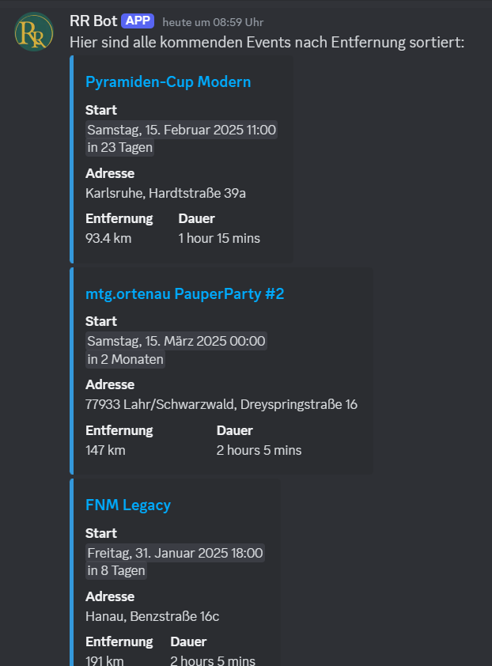

# Changelog

## 23. Oktober 2026

### Behoben

- Unveraenderte Turnierkalender und Format-Uebersichten werden nicht erneut bearbeitet.
- Discord-Edit-Limit 30046 beim Turnierkalender wird protokolliert, ohne Teilnehmeraktionen abzubrechen; ein spaeteres Update versucht die Aktualisierung erneut.

## 20. April 2026

### Geändert

- In den finalen Turnier-Standings werden Deck-Links angezeigt.

## 16. April 2026

### Geändert

- Der YouTube-Feed wurde auf API v3 umgestellt.
- Das Polling läuft nun im 10-Minuten-Takt und berücksichtigt einen `content_type`-Wert.

## 13. April 2026

### Hinzugefügt

- Bei **📅paper-turniere**-Posts kann nun eine Event-URL mit angegeben werden.

## 31. März 2026

### Hinzugefügt

- Eine Turnierübersicht nach Formaten wurde ergänzt.

### Behoben

- Übersichtsnachrichten werden aufgeteilt, um Discord-Längenlimits zuverlässig einzuhalten.

## 29. März 2026

### Hinzugefügt

- Bann-Befehl für SpellTable-Turniere inklusive Durchsetzung hinzugefügt.

### Geändert

- Gebannte Nutzer werden aus laufenden Anmeldelisten entfernt.

## 27. März 2026

### Hinzugefügt

- Im Turnier-Editor kann der Titel/Name nachträglich bearbeitet werden.
- Bei erhöhter Teilnehmerzahl werden Personen auf der Warteliste automatisch nachgezogen.
- Hall-of-Fame-Filter nutzen deutsche Slash-Optionen.

### Geändert

- Das Turnierformat wird automatisch aus Kanal oder Kategorie erkannt.
- Hall of Fame liest Daten direkt aus `tournaments.db`.

### Behoben

- Die Umbenennung von Threads bei Titeländerungen wurde robuster gemacht.
- Das Flackern der Standings-Nachricht beim Starten/Abschließen wurde behoben.

## 20. März 2026

### Hinzugefügt

- Variable Teilnahmegebühren (Bereiche) für **📅paper-turniere**.
- Slash-Command für Turnier-User-Sync hinzugefügt.

### Geändert

- SpellTable-Turniere wurden auf SQLite-basierte Persistenz umgestellt.
- Legacy-Turniere aus Textkanälen werden weiterhin unterstützt.

### Behoben

- Match-Validierung im Swiss-Format liefert klarere Fehlermeldungen.
- Fehler beim Bearbeiten fremder Nachrichten (`Forbidden`) werden abgefangen.

## 2. März 2026

### Hinzugefügt

- Hall-of-Fame-System für Turniersiege und Teilnehmerstatistiken.
- Infrastruktur für einen Paper-Events-Kalender ergänzt.

### Geändert

- Turnieraktionen sind stärker auf Organisatoren beschränkt.

### Behoben

- Race Condition beim Starten neuer Runden behoben.
- Fehler bei archivierten Threads beim Aktualisieren von Nachrichten behoben.

## 19. November 2025

### Geändert

- Beim Start wird kein Guild-Chunking mehr erzwungen.

## 13. November 2025

### Behoben

- Hintergrund-Loops werden nur gestartet, wenn sie nicht bereits laufen.

## 12. November 2025

### Geändert

- Globaler Instagram-Cache eingeführt.

## 10. November 2025

### Geändert

- Instagram-Funktionalität reaktiviert und Logging bei der Initialisierung verbessert.

## 27. Oktober 2025

### Hinzugefügt

- Spieler mit offenen Matches können automatisch erinnert werden.

### Geändert

- Turnierorganisator, Admins und Moderatoren können Ergebnisse setzen bzw. überschreiben.

## 24. Oktober 2025

### Hinzugefügt

- Deck-Einreichung ist auch nach abgeschlossenem Turnier möglich.

### Behoben

- Korrekturen am Turnierkalender sowie an der Behandlung bereits abgeschlossener oder abgebrochener Turniere.

## 13. Oktober 2025

### Hinzugefügt

- Mod-Ticket-Funktion implementiert.

## 26. September 2025

### Geändert

- Der Status des Bots zeigt, wie viele Turniere aktuell laufen.

## 25. September 2025

### Hinzugefügt

- Beim Übermitteln von Turnierergebnissen kann nun eine Nachricht an den Gegner hinterlassen werden.

## 2. September 2025

### Behoben

- MTGTop8-Links werden nun auch mit `www.` am Anfang erkannt.

## 10. April 2025

### Geändert

- Anpassung des Vorgangs für die **📅paper-turniere**-Einreichung.
- Posts können nun vom Author nachträglich bearbeitet werden.
- Das betrifft auch die Posts, die bereits gemacht wurden.
- Hier eine kleine Demonstration:
  - https://www.youtube.com/watch?v=8Xzmw53KXm8

## 1. April 2025

### Hinzugefügt

- Alpha-Veröffentlichung der Turnier-Software. Befehl: `/erstelle_turnier`

## 25. März 2025

### Geändert

- Arena Daily Deals werden nicht mehr als Bluesky-Link gepostet, sondern direkt die Bilder des Stores (aus dem Bluesky-Post).

## 13. Februar 2025

### Behoben

- `/poste_turnier`
  - Bei Fehlern wird eine Rückmeldung an den Anwender gegeben (wird diesem vermutlich nicht viel sagen, aber dem Entwickler 😉).
  - Der Bot reagiert sofort nach einer Anfrage zumindest mit „…, Augenblick ⏳“, damit man nicht von einem Absturz ausgeht.

## 12. Februar 2025

### Geändert

- `/poste_turnier`
  - Für Event Typ gibt es nun auch eine Auswahlliste, statt Freitext angeben zu müssen.

### Behoben

- `/poste_turnier`
  - Format(e) und Event Typ werden jetzt auch in die Datenbank geschrieben.

## 12. Februar 2025

### Geändert

- `/poste_turnier`
  - Für Format(e) wird nun eine Auswahlliste angeboten, anstatt dass man Freitext eingeben muss.

## 11. Februar 2025

### Hinzugefügt

- `/poste_turnier` Befehl
  - <Erklärung folgt>

## 7. Februar 2025

### Hinzugefügt

- Arena Daily Deals: Der Bot prüft alle 15 Minuten, ob Arena Daily Deals auf Bluesky einen neuen Post gemacht hat. Ist das der Fall, wird der Link zum Post in 🏟mtg-arena gesendet.

## 31. Januar 2025

### Hinzugefügt

- Bei der `remind-me`-Funktion wird nun nach einer Bestätigung gebeten, ob das interpretierte Datum auch das Gewollte ist.
- Schlägt die Datumserkennung durch `dateparser` fehl, wird es mit `gemini-1.5-flash` versucht. Für die Transparenz, der Prompt ist: `Jetzt ist {now}. Welches Datum und Uhrzeit ist {user_time_input}? Prüfe das Ergebnis nochmal nach! Gib mir nur das Datum mit Uhrzeit.`

## 27. Januar 2025

### Hinzugefügt

- `remind-me`-Funktion nun auch als Slash Command: **/erinnere_mich**

### Geändert

- Schlägt die Datumserkennung fehl, kann man die Eingabe noch einmal versuchen.

## 25. Januar 2025

### Behoben

- Fehler im Titel von **[📅paper-turniere](https://discord.com/channels/783441128119730236/1207651082491142154)**-Einträgen.

### Geändert

- Verwendet nun eine andere Bibliothek, um Zeiteinträge für die `remind-me`-Funktion zu parsen. Sollte nun intuitiver sein.

## 23. Januar 2025

### Hinzugefügt

- **/events_in_meiner_nähe** Prototyp für einen Befehl, der einem alle eingereichten **[📅paper-turniere](https://discord.com/channels/783441128119730236/1207651082491142154)** nach Entfernung sortiert als Privatnachricht schickt. Der Link führt zu den jeweiligen **[📅paper-turniere](https://discord.com/channels/783441128119730236/1207651082491142154)**-Foreneinträgen.

## 22. Januar 2025

### Hinzugefügt

- `.ics`-Dateien sind zurück für neue Posts in **[📅paper-turniere](https://discord.com/channels/783441128119730236/1207651082491142154)**.

## 18. Januar 2025

### Hinzugefügt

- Möglichkeit, eigenes Bild für **[📅paper-turniere](https://discord.com/channels/783441128119730236/1207651082491142154)** anzugeben.

### Behoben

- Wenn Ende eines Events/Turniers gleich dem Start ist (kein Ende angegeben), dann wird dieses auch nicht mit dazu geschrieben.