# Feature Overview

## Erstelle Turnier

`/erstelle_turnier`

- Befehl in einem normalen Text-Kanal verwenden (kein Thread oder Forum), da der Bot einen Thread für das Turnier erstellt.

    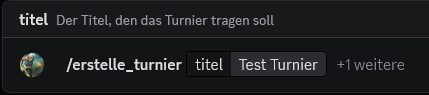

    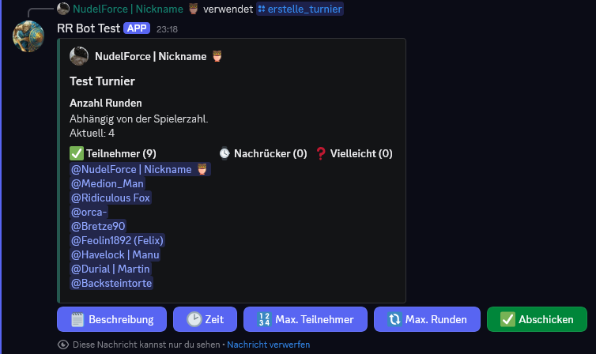

- Nach dem Abschicken wird im aktuellen Kanal ein Turnier-Thread erstellt.

    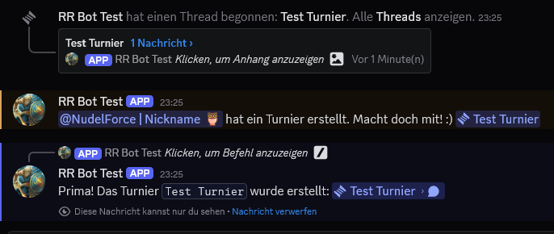

- Mitglieder können teilnehmen, der Organisator kann das Turnier starten.

    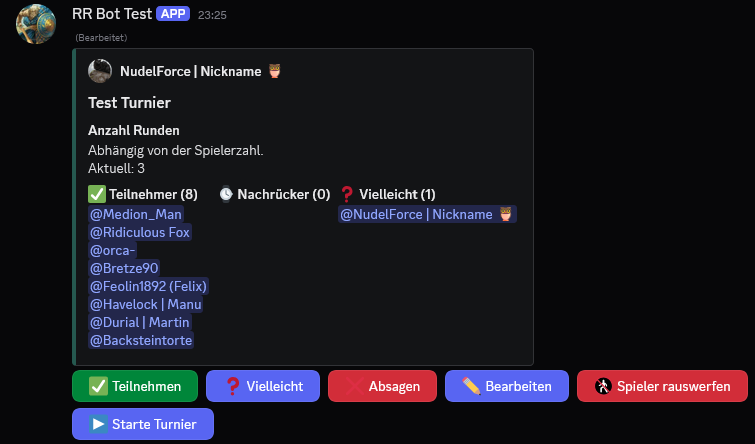

- Nach dem Start werden automatisch die ersten Pairings erstellt.

    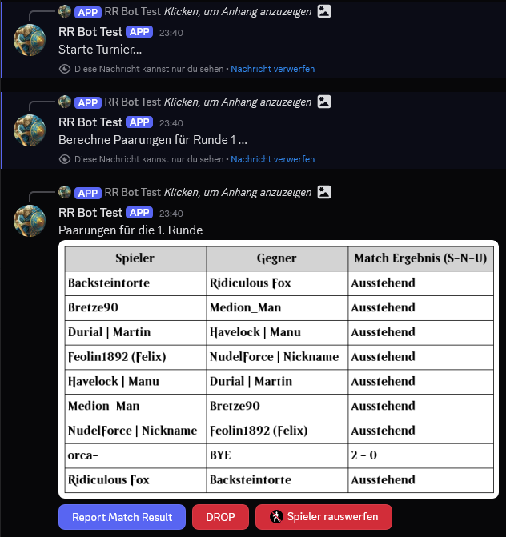

- Ergebnisse können pro Match gemeldet und bestätigt werden.

    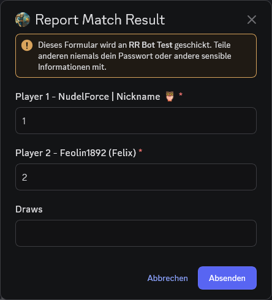

    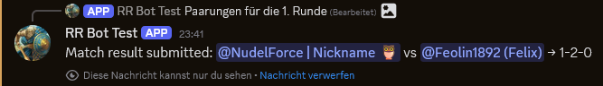

- Übermittelte Ergebnisse und Standings werden fortlaufend angezeigt.

    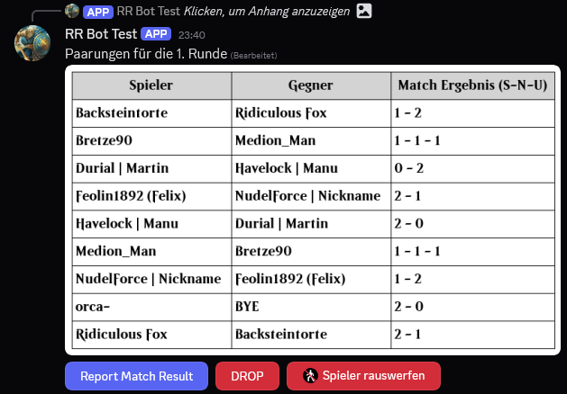

    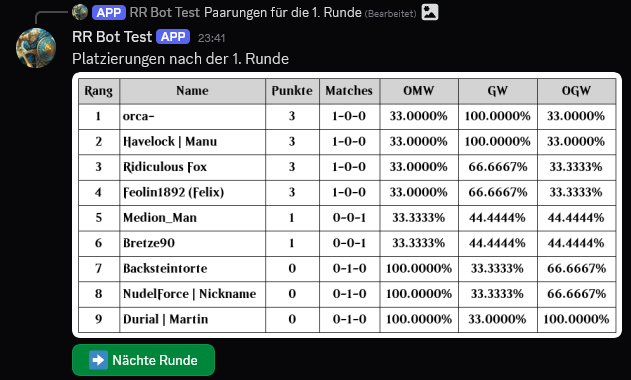

    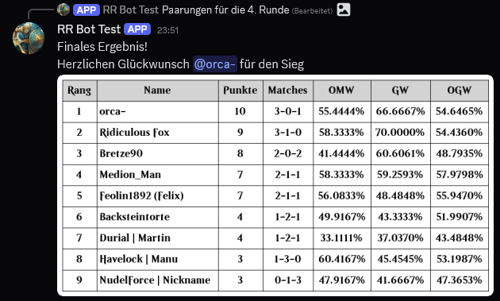

## YouTube

[**@GameRii Youtube**](https://www.youtube.com/@GameRii)

- Neue Videos werden in **[📯ankündigungen](https://discord.com/channels/783441128119730236/783635566574305280)** gepostet.
- Ersetzt den bisherigen 3rd-Party-Bot.

## Paper Events

`/poste_turnier`

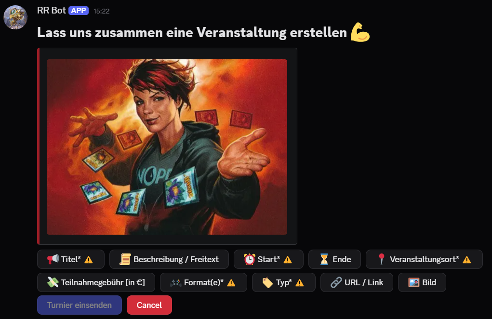

- Im Privatchat mit dem Bot werden die Angaben zum Paper Turnier/Event angegeben.
- Wenn mindestens die Pflichtfelder (⚠️) ausgefüllt sind (✅), kann das Turnier/Event gepostet werden.
- Der Eintrag wird in eine öffentlich einsehbare [Datenbank](https://www.notion.so/f05d532cf91f4f9cbce38e27dc85b522?pvs=21) geschrieben.
- Zusätzlich wird das Event im Kanal **[📅paper-turniere](https://discord.com/channels/783441128119730236/1207651082491142154)** gepostet.
- Demonstration: https://www.youtube.com/watch?v=8Xzmw53KXm8

## Ask Us Anything

- Einträge in **[❓ask-us-anything](https://discord.com/channels/783441128119730236/795760555607851058)** werden in eine Datenbank geschrieben.
- So kann Robin schnell sehen, welche Fragen noch offen sind.

## Erinnere mich ...

- Über das Kontextmenü einer Nachricht unter Apps: **Erstelle Erinnerung ...**
- Öffnet ein Dialogfenster, in dem ein Datum oder eine relative Zeit angegeben werden kann.
- Zum gewählten Zeitpunkt erinnert der Bot per Direktnachricht an den ursprünglichen Post.
- Zusätzlich als Slash-Command verfügbar: `/erinnere_mich`

## Arena Daily Deals

- Der Bot prüft alle 15 Minuten, ob auf https://bsky.app/profile/arenadailydeals.bsky.social ein neuer Beitrag veröffentlicht wurde.
- Wenn ein neuer Beitrag vorhanden ist, wird der Link im Kanal [🏟mtg-arena](https://discord.com/channels/783441128119730236/783636261189582869) geteilt.